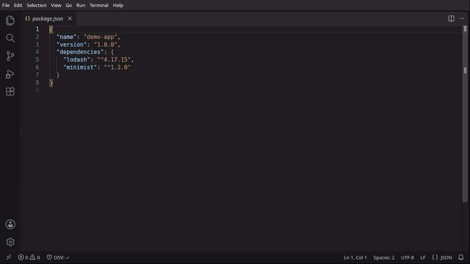

# OSV Vulnerabilities

Find known vulnerabilities in your dependencies while you edit, and fix them in one click.
Dependency manifests and lockfiles are checked against [OSV.dev](https://osv.dev), and every
finding is shown right on the line that declares the package.

This repository contains:

| Package | What it is |
|---|---|
| [`packages/vscode-osv`](packages/vscode-osv) | The VS Code extension (a thin client) |
| [`packages/osv-language-server`](packages/osv-language-server) | The language server, plus the `osv-check` CLI for pre-commit hooks and CI |

Supported ecosystems: **npm**, **PyPI**, **Rust** (Cargo), **Java/Kotlin** (Maven and Gradle), **Go**, **C#** (NuGet),
**Ruby** (RubyGems), **PHP** (Packagist), **GitHub Actions**, **Dart/Flutter** (Pub), **Elixir** (Hex) and **Swift**.

## Features

- **Inline diagnostics** on manifests and lockfiles, with severity from CVSS scores
  (critical/high are errors, medium is a warning, low is information).
- **Hover details** for each vulnerable package: severity badge, the version that fixes it with an
  Update link up front, then each advisory with its aliases (CVE IDs) and summary.
- **Vulnerabilities view**: an activity-bar tree of every vulnerable dependency in the workspace,
  grouped by file or by severity. Click to jump to the line, or fix, ignore or open the advisory inline.
- **One-click fixes**: update a dependency to the lowest version that fixes the vulnerabilities,
  with the manifest edit preserving your range style (`^`, `~`, `>=`, ...). Transitive
  dependencies are fixed with overrides/resolutions where the package manager supports them.
- **Lockfile refresh**: after a fix, offers to run the right command (`npm install`,
  `uv lock`, ...) in a visible terminal. Disabled in Restricted Mode.
- **Status bar**: a severity breakdown for the active file (`OSV: 1 critical · 1 high`), `OSV: ✓` when
  clean, `OSV: offline`, and a spinner during workspace scans. Click it to open the Vulnerabilities view.
- **Offline friendly**: results are cached on disk and served (marked `cached`) when OSV.dev
  is unreachable.
- **Ignore list**: suppress a vulnerability from settings or from an `osv-scanner.toml`.
- **Pre-commit and CI**: the `osv-check` command, see [docs/pre-commit.md](docs/pre-commit.md).
- **Any editor or AI agent** that speaks LSP: see [docs/agents.md](docs/agents.md).

### In the editor

Findings appear on the line that declares the package. Hover for the advisories, then apply the
quick fix to move to the fixed version, keeping your range style.



### On the command line

`osv-check` runs the same scan in a terminal, a pre-commit hook or CI (see
[docs/pre-commit.md](docs/pre-commit.md)).



### Supported files

| Ecosystem | Files |
|---|---|
| npm | `package.json`, `package-lock.json`, `npm-shrinkwrap.json`, `yarn.lock`, `pnpm-lock.yaml`, `bun.lock` |
| PyPI | `requirements*.txt`, `requirements/*.txt`, `pyproject.toml`, `Pipfile`, `Pipfile.lock`, `poetry.lock`, `uv.lock`, `pdm.lock`, `pylock.toml`, `pylock.*.toml` |
| Rust (crates.io) | `Cargo.toml`, `Cargo.lock` |
| Java/Kotlin (Maven) | `pom.xml`, `build.gradle`, `build.gradle.kts`, `gradle/libs.versions.toml`, `gradle.lockfile`, `buildscript-gradle.lockfile` |
| Go | `go.mod` |
| C# (NuGet) | `*.csproj`, `*.fsproj`, `*.vbproj`, `Directory.Packages.props`, `Directory.Build.props`, `packages.config`, `packages.lock.json` |
| Ruby (RubyGems) | `Gemfile`, `gems.rb`, `*.gemspec`, `Gemfile.lock`, `gems.locked` |
| PHP (Packagist) | `composer.json`, `composer.lock` |
| GitHub Actions | `.github/workflows/*.yml`, `.github/workflows/*.yaml`, `action.yml`, `action.yaml` |
| Dart/Flutter (Pub) | `pubspec.yaml`, `pubspec.lock` |
| Elixir (Hex) | `mix.exs`, `mix.lock` |
| Swift (SwiftPM) | `Package.swift`, `Package.resolved` |

### Known limitations

- **Heuristic parsers.** `Gemfile`, `*.gemspec`, `mix.exs`, `Package.swift` and `build.gradle(.kts)` are
  scanned with line- and token-based heuristics, not by the real Ruby, Elixir, Swift or Groovy/Kotlin
  parsers. Declarations built dynamically are not seen.
- **`Gemfile`:** the parser is line-based. It skips version arrays and heredocs.
- **`mix.exs`:** only the first list literal in the `deps` function is read, so deps built with `++`,
  conditionals or `@attr` module attributes are missed.
- **`Package.swift`:** package URLs are recognised only for hosts with a dot, so `localhost`, IPv6
  and underscore hosts are skipped.
- **Lower-bound fallback.** When a manifest declares a range and there is no lockfile, the lower
  bound of the range is checked, so a vulnerability that only affects newer versions inside the range
  is not reported. Such findings are marked as a lower-bound check.
- **NuGet casing without a lockfile.** NuGet package IDs are case-insensitive, but without a lockfile
  the name is checked as written in the project file.
- **GitHub Actions.** OSV returns nothing for a versioned query on an action, so the extension asks for
  every record on the action and matches your ref against the affected ranges itself. Only
  version-like refs (`v4`, `4.1`, `v4.1.2`) are checked; commit SHAs, branches and local or Docker
  `uses:` entries are skipped.

## Privacy

- Only package name, version and ecosystem are sent, and only to `osv.apiBaseUrl`.
- No file contents, paths, project names, or identifiers are sent. No telemetry.

## Settings

| Setting | Default | Description |
|---|---|---|
| `osv.enable` | `true` | Master switch (workspace-scoped) |
| `osv.ecosystems` | all enabled | Object of per-ecosystem booleans, e.g. `{ "npm": true, "pypi": false }` |
| `osv.minimumSeverity` | `"low"` | Hide findings below this level |
| `osv.onlyShowFixable` | `false` | Only show vulnerabilities with an official fix (a fixed version in the OSV record); ones with no fix yet are hidden |
| `osv.scanLockfiles` | `true` | Highlight entries inside lockfiles |
| `osv.scanWorkspaceOnStartup` | `false` | Run workspace scan when the server starts |
| `osv.cacheTtlHours` | `48` | Package-result freshness, minimum 1 |
| `osv.apiBaseUrl` | `"https://api.osv.dev"` | OSV API base (mirror/proxy) |
| `osv.caCertificatePath` | `""` | PEM file of extra CA certificates to trust (see below) |
| `osv.ignoredVulnerabilities` | `[]` | Vulnerability IDs (any alias) to suppress |
| `osv.offerLockCommand` | `"ask"` | `ask` \| `always` \| `never` |

**Corporate CA certificates:** behind a TLS-inspecting proxy, set `osv.caCertificatePath` to a PEM
file, or set the standard `SSL_CERT_FILE` variable to one. `SSL_CERT_DIR` is also read: every `.pem`
or `.crt` file in it is trusted. These are added to the default trust store, not used in its place.
An empty setting falls back to `SSL_CERT_FILE`. For this repo, put `SSL_CERT_FILE=/path/to/ca.pem`
in a `.env` file at the root: `just` loads it, `just vscode` also sets `NODE_EXTRA_CA_CERTS` so
VS Code's own requests (such as JSON schema downloads) trust it, and `.env` is gitignored. Because
`just` exports `.env` to every recipe, other tools run through `just` also see `SSL_CERT_FILE`. The
setting is ignored in untrusted workspaces.

**Ignore file:** an `osv-scanner.toml` in the workspace root (or any ancestor of the scanned
file up to the root) is read for `[[IgnoredVulns]]` entries (`id`, optional `ignoreUntil`,
`reason`). Expired `ignoreUntil` entries are not applied. Matching is by any alias.

## Commands

- `OSV: Scan workspace`
- `OSV: Clear cache and rescan`
- `OSV: Show output log`

## Documentation

- [Pre-commit hooks and CI](docs/pre-commit.md)
- [Using the language server from AI agents and other editors](docs/agents.md)
- [Design specification](docs/superpowers/specs/2026-10-18-osv-vscode-extension-design.md)

## Development

```
npm ci
npm run build
npm test
npm run lint
npm run typecheck
scripts/test-precommit.sh     # needs the pre-commit tool and network access
```

## License

[MIT](LICENSE)
