# Using osv-check in pre-commit hooks and CI

`osv-check` is a command-line scanner that ships in the `osv-language-server` npm package
(it installs two binaries: `osv-language-server` and `osv-check`). It uses the same engine as
the VS Code extension and reports known vulnerabilities (from [OSV.dev](https://osv.dev)) in
npm, PyPI, Cargo, Maven/Gradle, Go, NuGet, RubyGems, Packagist, GitHub Actions, Pub, Hex and Swift manifests and lockfiles.

```
osv-check [options] [paths...]
```

## Options

| Flag | Default | VS Code setting | Description |
|---|---|---|---|
| `--min-severity <level>` | `low` | `osv.minimumSeverity` | Hide findings below `low`, `medium`, `high` or `critical` |
| `--only-fixable` | off | `osv.onlyShowFixable` | Hide findings with no official fix (no fixed version in the OSV record) |
| `--no-lockfiles` | lockfiles scanned | `osv.scanLockfiles` (inverted) | Skip lockfile entries |
| `--disable-ecosystem <id>` | all enabled | `osv.ecosystems` (`{ "<id>": false }`) | Do not scan an ecosystem. Repeatable. Ids: `npm`, `pypi`, `cargo`, `maven`, `go`, `nuget`, `rubygems`, `packagist`, `githubActions`, `pub`, `hex`, `swift` |
| `--ignore <id>` | none | `osv.ignoredVulnerabilities` | Suppress a vulnerability by any alias (GHSA, CVE, PYSEC, ...). Repeatable. `osv-scanner.toml` is honoured as well |
| `--cache-dir <dir>` | per-user cache | (the server's `--cache-dir`) | Override the cache location |
| `--cache-ttl-hours <n>` | `48` | `osv.cacheTtlHours` | How long cached package results stay fresh (minimum 1) |
| `--api-base-url <url>` | `https://api.osv.dev` | `osv.apiBaseUrl` | OSV API base, for a mirror or proxy |
| `--ca-certificate-path <file>` | none | `osv.caCertificatePath` | PEM file of extra CA certificates to trust. Without it `SSL_CERT_FILE` and `SSL_CERT_DIR` are used |
| `--format <format>` | `text` | none | `text`, `json` or `tree` (below) |
| `--strict` | off | none | Exit `2` when OSV is unreachable and nothing is cached |
| `--help`, `--version` | | | |

The extension settings `osv.enable`, `osv.scanWorkspaceOnStartup`, `osv.offerLockCommand` and
`osv.overview.groupBy` have no CLI equivalent: they only affect editor behaviour.
Proxies are read from `HTTPS_PROXY`, `HTTP_PROXY` and `NO_PROXY`.

## Output formats

`--format text` (default) prints one line per finding and a severity breakdown.

`--format json` prints `{ "findings": Finding[], "offline": boolean }`, the same `Finding`
shape as the language server's `osv.getFindings`.

`--format tree` prints a `tree`-style listing of directories, files, vulnerable dependencies and
their advisories. It is plain Unicode with no colour and one node per line, so it reads well in
CI logs and is easy to `grep`. Combined with `--only-fixable` it lists only what an upgrade
can resolve:

```
$ osv-check --format tree --only-fixable
.
├── api
│   └── requirements.txt
│       └── requests 2.19.0 → 2.33.0 [high] (line 1)
│           ├── GHSA-x84v-xcm2-53pg (CVE-2018-18074) [high] Insufficiently Protected Credentials in Requests
│           └── GHSA-9hjg-9r4m-mvj7 (CVE-2024-47081) [medium] Requests vulnerable to .netrc credentials leak via malicious URLs
└── package.json
    └── minimist 1.2.0 → 1.2.6 [critical] (line 6)
        ├── GHSA-xvch-5gv4-984h (CVE-2021-44906) [critical] Prototype Pollution in minimist
        └── GHSA-vh95-rmgr-6w4m (CVE-2020-7598) [medium] Prototype Pollution in minimist

2 vulnerable dependencies in 2 files
```



Paths that are not recognised manifests or lockfiles are ignored, so a hook can safely pass
every staged file. **With no paths, `osv-check` scans the whole tree under the current
directory** (skipping `node_modules`, `target`, `vendor`, `.git`, `dist`, `build`), which is
why the hand-written hooks below exit early when nothing relevant is staged.

> Because the binary lives in the `osv-language-server` package, `npx` must be told which
> package to fetch: `npx --yes --package osv-language-server osv-check ...`. (A bare
> `npx osv-check` would look for a different package named `osv-check`.)

## Exit codes

| Code | Meaning |
|---|---|
| `0` | No findings at or above `--min-severity` (or offline with no cache, unless `--strict`) |
| `1` | One or more findings. Output lists each one; the commit is blocked |
| `2` | Usage error, or OSV unreachable with no cache under `--strict` |

## Offline behaviour

`osv-check` shares an on-disk cache with the language server. When OSV.dev cannot be reached
it uses cached results, including stale ones, and marks the output as offline. With no cache
at all it prints a warning to stderr and exits `0`, so a commit is never blocked just because
you are on a plane. In CI, pass `--strict` so that an unreachable OSV fails the job with
exit code `2` instead of passing silently.

## Ignoring a vulnerability

Create an `osv-scanner.toml` in the repository root (or in any directory above the scanned
file, up to the root):

```toml
[[IgnoredVulns]]
id = "GHSA-p6mc-m468-83gw"        # any alias of the vulnerability works
ignoreUntil = 2027-01-01          # optional; expired entries are not applied
reason = "Not reachable: we never pass user input to this function"
```

Matching is by any alias (GHSA, CVE, PYSEC, ...). The same file is honoured by the VS Code
extension and the language server.

## 1. pre-commit framework

`.pre-commit-config.yaml`:

```yaml
repos:
  - repo: https://github.com/SrzStephen/vscode-osv
    rev: v0.1.0
    hooks:
      - id: osv-check
        args: [--min-severity, high]
```

The hook (`.pre-commit-hooks.yaml` in this repository) uses `language: node` and installs
`osv-language-server` from npm. It runs only when a staged file matches one of the supported
manifest or lockfile names: `package.json`, `package-lock.json`, `npm-shrinkwrap.json`,
`yarn.lock`, `pnpm-lock.yaml`, `bun.lock`, `requirements*.txt`, `requirements/*.txt`,
`pyproject.toml`, `Pipfile`, `Pipfile.lock`, `poetry.lock`, `uv.lock`, `pdm.lock`,
`pylock.toml`, `pylock.*.toml`, `Cargo.toml`, `Cargo.lock`, `pom.xml`, `build.gradle`, `build.gradle.kts`, `gradle/libs.versions.toml`, `gradle.lockfile`, `buildscript-gradle.lockfile`, `go.mod`, `*.csproj`, `*.fsproj`, `*.vbproj`, `Directory.Packages.props`, `Directory.Build.props`, `packages.config`, `packages.lock.json`, `Gemfile`, `gems.rb`, `*.gemspec`, `Gemfile.lock`, `gems.locked`, `composer.json`, `composer.lock`, `.github/workflows/*.yml`, `.github/workflows/*.yaml`, `action.yml`, `action.yaml`, `pubspec.yaml`, `pubspec.lock`, `mix.exs`, `mix.lock`, `Package.swift` and `Package.resolved`. The `files:` regex is generated from the ecosystem modules (`npm run sync-patterns`), so it stays in step with them.

This hook is exercised end to end by `scripts/test-precommit.sh`.

## 2. Plain git hook

Save as `.git/hooks/pre-commit` and make it executable (`chmod +x`):

```sh
#!/bin/sh
# Exit early when nothing is staged: osv-check with no paths scans the whole tree.
[ -z "$(git diff --cached --name-only --diff-filter=ACM)" ] && exit 0
git diff --cached --name-only -z --diff-filter=ACM |
  xargs -0 npx --yes --package osv-language-server osv-check
```

`xargs` returns a non-zero status when `osv-check` does, which aborts the commit.

## 3. Husky

With [Husky](https://typicode.github.io/husky/) v9, `.husky/pre-commit` contains:

```sh
[ -z "$(git diff --cached --name-only --diff-filter=ACM)" ] && exit 0
git diff --cached --name-only -z --diff-filter=ACM |
  xargs -0 npx --yes --package osv-language-server osv-check
```

## 4. lefthook

`lefthook.yml`:

```yaml
pre-commit:
  commands:
    osv-check:
      glob: "*.{txt,json,toml,lock,yaml}"
      run: npx --yes --package osv-language-server osv-check {staged_files}
```

The `glob` is deliberately broad (lefthook matches it against file names in any directory);
`osv-check` ignores staged files that are not recognised manifests or lockfiles. lefthook skips
the command when no staged file matches, so it is never run with an empty path list.

## 5. GitHub Actions

```yaml
- name: Check dependencies for known vulnerabilities
  run: npx --yes --package osv-language-server osv-check --strict --format json
```

This scans the whole checkout. `--format json` (or `--format tree` for a readable log) writes to
stdout; the step fails on exit code `1`
(findings) or `2` (OSV unreachable with `--strict`).
