# osv-language-server

A Language Server (LSP) and CLI that report known vulnerabilities from
[OSV.dev](https://osv.dev) in npm, PyPI, Cargo, Maven/Gradle, Go, NuGet, RubyGems, Packagist, GitHub Actions, Pub, Hex and Swift dependency manifests and lockfiles, with quick fixes.
It powers the OSV Vulnerabilities VS Code extension and works with any LSP client.



## Binaries

| Binary | Purpose |
|---|---|
| `osv-language-server --stdio` | The language server (also `--node-ipc`; optional `--cache-dir <dir>`) |
| `osv-check [paths...]` | CLI scanner for pre-commit hooks and CI. Exit `0` clean, `1` findings, `2` usage error or (`--strict`) network failure |

```
npx --yes osv-language-server --stdio
npx --yes --package osv-language-server osv-check --min-severity high
```

Requires Node 22 or later.

## Documentation

- [Agent and editor integration](../../docs/agents.md): initialization options, diagnostic data,
  `workspace/executeCommand` commands, Claude Code and Neovim setup.
- [Pre-commit hooks and CI](../../docs/pre-commit.md)

## Privacy

- Only package name, version and ecosystem are sent, and only to the configured OSV API base URL.
- No file contents, paths, project names, or identifiers are sent. No telemetry.
