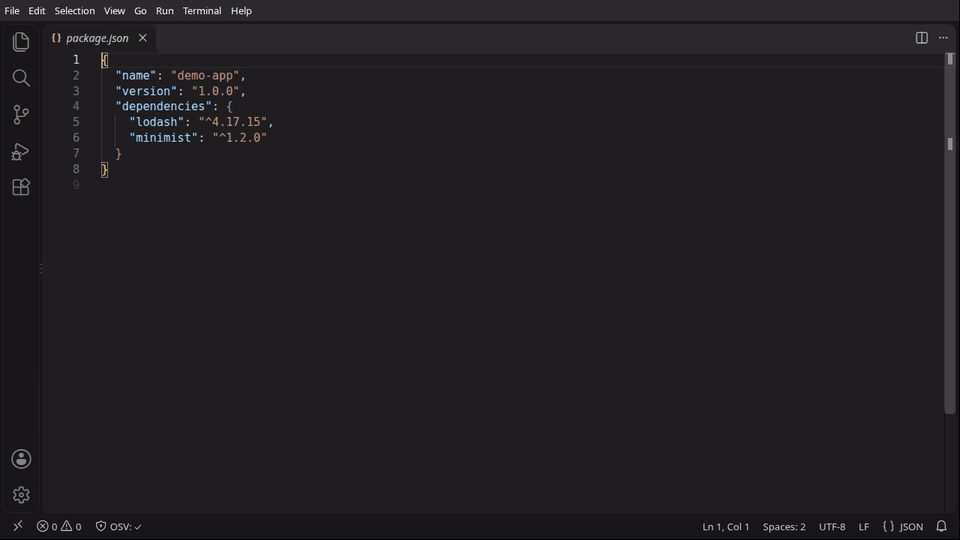

# OSV Vulnerabilities for VS Code

Highlights known vulnerabilities ([OSV.dev](https://osv.dev)) in npm, PyPI, Cargo, Maven/Gradle, Go, NuGet, RubyGems, Packagist, GitHub Actions, Pub, Hex and Swift dependency
manifests and lockfiles, with one-click fixes.

## Features

- Inline diagnostics on manifests and lockfiles, with severity from CVSS.
- Hover details with a severity badge, the fixing version and an Update link up front, then each advisory with its aliases (CVE IDs).
- `Update <package> to <version>` quick fixes that preserve your range style.
- A **Vulnerabilities** view in the activity bar: every vulnerable dependency in the workspace, grouped by file or severity
  (`osv.overview.groupBy`), with jump-to-line, fix, ignore and open-advisory actions.
- Offers to refresh the lockfile after a fix (never in Restricted Mode).
- Status bar: a severity breakdown such as `OSV: 1 critical · 1 high`, `OSV: ✓` when clean, `OSV: offline`, and a spinner
  while scanning; click it to open the Vulnerabilities view.
- Works offline from a disk cache.

## Privacy

- Only package name, version and ecosystem are sent, and only to `osv.apiBaseUrl`.
- No file contents, paths, project names, or identifiers are sent. No telemetry.

## Settings

| Setting | Default | Description |
|---|---|---|
| `osv.enable` | `true` | Master switch (workspace-scoped) |
| `osv.ecosystems` | all enabled | Object of per-ecosystem booleans |
| `osv.minimumSeverity` | `"low"` | Hide findings below this level |
| `osv.onlyShowFixable` | `false` | Only show vulnerabilities with an official fix (a fixed version in the OSV record); ones with no fix yet are hidden |
| `osv.scanLockfiles` | `true` | Highlight entries inside lockfiles |
| `osv.scanWorkspaceOnStartup` | `false` | Run workspace scan when the server starts |
| `osv.cacheTtlHours` | `48` | Package-result freshness, minimum 1 |
| `osv.apiBaseUrl` | `"https://api.osv.dev"` | OSV API base (mirror/proxy) |
| `osv.ignoredVulnerabilities` | `[]` | Vulnerability IDs (any alias) to suppress |
| `osv.offerLockCommand` | `"ask"` | `ask` \| `always` \| `never` |
| `osv.overview.groupBy` | `"file"` | Group the Vulnerabilities view by `file` or `severity` |

An `osv-scanner.toml` with `[[IgnoredVulns]]` entries (`id`, optional `ignoreUntil`, `reason`)
in the workspace root is also honoured.

## Commands

`OSV: Scan workspace`, `OSV: Clear cache and rescan`, `OSV: Show output log`.

## More

Pre-commit hooks, CI and other editors: see `README.md`, `docs/pre-commit.md` and
`docs/agents.md` in the source repository.

<!-- TODO: link these once the repository URL is set (relative links break vsce packaging). -->

